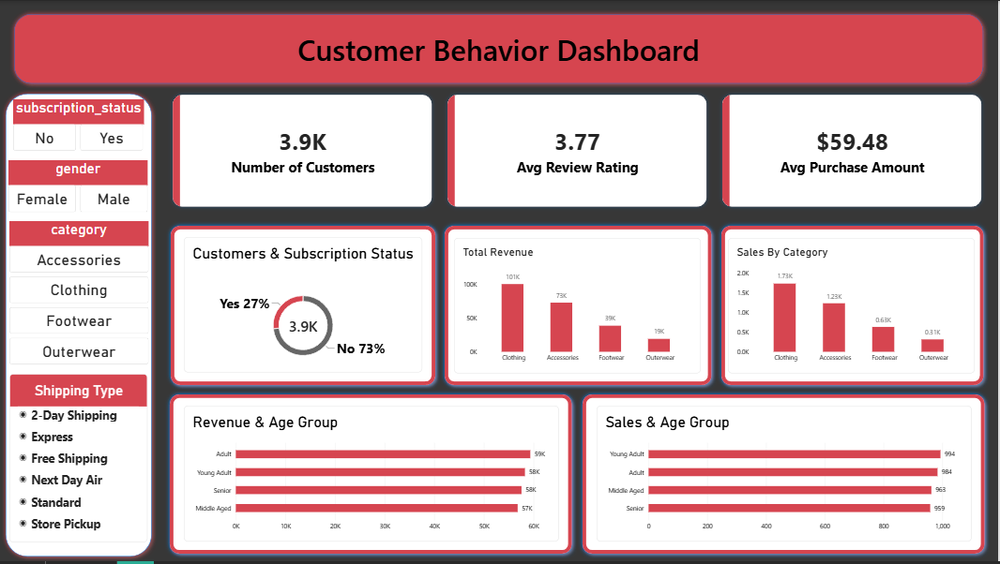

# Customer Behavior Analysis

A data analytics project on retail customer shopping behavior. The data is cleaned in Python, analyzed with SQL in MySQL, and presented in a Power BI dashboard, a report, and a presentation.

## Overview

The project looks at who the customers are, what they buy, and what drives their spending, and ends with simple business recommendations.

## Dataset

- File: `customer_behav_final.csv`
- About 3,900 customers
- Includes age, gender, location, item, category, purchase amount, review rating, subscription status, shipping type, discount, and purchase history

Note: `age_group` and `purchase_frequency_days` are not in the original CSV. The Python script creates them before loading the data into MySQL, so the SQL queries only work after the script has run.

## Tools

Python (pandas, SQLAlchemy), MySQL, Power BI, Gamma

## Steps

1. Load and explore the data in Python.
2. Clean the data: fill missing review ratings, rename columns, create new columns, drop `promo_code_used`.
3. Load the cleaned data into MySQL.
4. Answer 10 business questions with SQL.
5. Build the Power BI dashboard.
6. Write the report and presentation.

## Dashboard

## Results

- Male customers bring in about two-thirds of total revenue.
- About 80% of customers are loyal, but only 27% subscribe.
- Subscribers spend only slightly more than non-subscribers.
- Shipping type and age group have little effect on spending.
- Clothing is the top-selling category.

## How to Run

1. Install the requirements: `pip install pandas sqlalchemy pymysql`
2. Create the database: `CREATE DATABASE cust_shopping_behavior;`
3. Add your MySQL password in the script (use an environment variable, not plain text).
4. Run `python customer_behavior.py` to clean the data and load it into MySQL.
5. Run the queries in `customer_behavior_queries.sql`.
